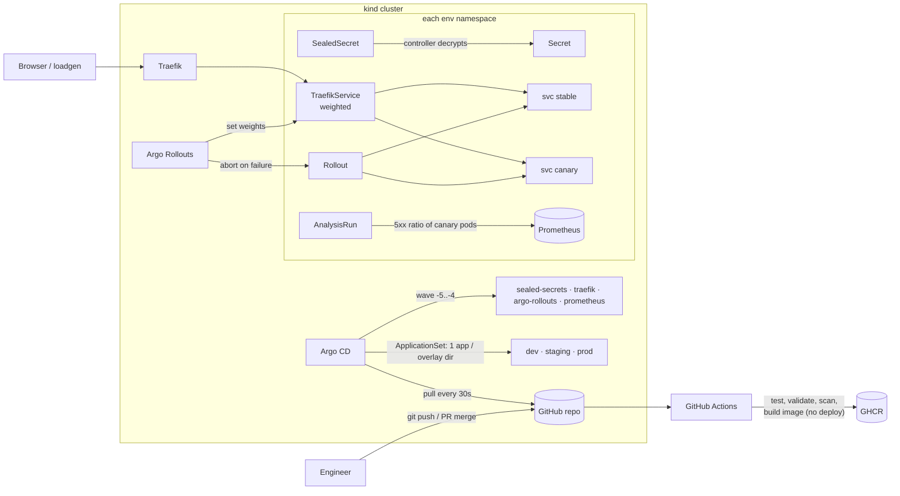

# Declarative GitOps & Progressive Delivery Platform

A production-shaped GitOps delivery framework on a local Kubernetes cluster.
**Git is the only interface**: versions, configuration, secrets, and promotions all change through commits. Argo CD reconciles them, and Argo Rollouts ships them as metrics-gated canaries that roll back automatically.

| Requirement | How it's met |
|---|---|
| Infrastructure automation | `bootstrap.sh`: idempotent kind cluster → Argo CD → app-of-apps. One command |
| GitOps model | Argo CD app-of-apps + `ApplicationSet` (git directory generator) over Kustomize overlays |
| Zero-trust secrets | Sealed Secrets with a bring-your-own key, strict scope, and CI gates (gitleaks + raw `Secret` ban) |
| Progressive delivery | Argo Rollouts canary with Traefik weighted routing; per-env step profiles |
| Traffic control without kubectl | Promotion = a changed `newTag` line; steps are timed, not manually promoted |
| Drift & self-heal | `selfHeal: true` everywhere; `demo.sh drift` tampers and times the revert |
| Container practices | requests/limits, LimitRange + ResourceQuota, default-deny NetworkPolicies, PSA `restricted`, non-root distroless, read-only root FS |
| **Bonus**: auto-rollback | Prometheus `AnalysisTemplate` on the canary's 5xx ratio; a breach aborts the rollout and shifts traffic back |

---

## Architecture



**Flow of a release:** commit a new tag → Argo CD syncs the changed `Rollout` → Argo Rollouts starts canary pods and shifts 10 → 25 → 50 → 75% of traffic through the weighted `TraefikService` → a background `AnalysisRun` queries Prometheus every 20s for the 5xx ratio of **canary pods only** (by `rollouts-pod-template-hash`). A pass promotes the canary. A failure aborts it: traffic returns to stable within seconds, the canary scales down, and the app shows `Degraded` until Git is reverted.

## Repository layout

```
├── bootstrap.sh / teardown.sh     # the only imperative entrypoints
├── cluster/kind-config.yaml       # 1 control-plane + 2 workers, :80/:443 -> Traefik
├── platform/                      # CLUSTER-WIDE concerns (platform team)
│   ├── argocd/values.yaml         #   Argo CD install values (bootstrap only)
│   ├── bootstrap/root-app.yaml    #   app-of-apps root
│   ├── apps/                      #   what Argo CD runs: AppProjects, platform apps, ApplicationSet
│   └── values/                    #   pinned Helm values per platform component
├── apps/demo-app/                 # APPLICATION state (product team)
│   ├── base/                      #   Rollout, Services, TraefikService, IngressRoute,
│   │                              #   AnalysisTemplate, NetworkPolicies, quotas, loadgen
│   └── overlays/{dev,staging,prod}/  # namespace, image tag, config, sealed secret, canary profile
├── app/                           # demo service source (Go, stdlib only) + Dockerfile
├── scripts/                       # seal-secret, build-images, demo driver
└── .github/workflows/             # ci.yaml (verify + build), promote.yaml (PR-based promotion)
```

**Separation:** platform components and application state live in separate trees, separate Argo CD `AppProject`s, and separate trust boundaries. The `apps` project can deploy only to `dev/staging/prod`, can create only `Namespace` at cluster scope, and cannot create RBAC.

**Environments are directories, not branches.** One `main` branch. The ApplicationSet turns every folder under `overlays/` into an Argo CD Application, so adding `overlays/qa/` creates a new environment. Promotion means changing one line (`newTag`) in the next overlay.

## Prerequisites

Windows: use WSL2 Ubuntu + Docker Desktop and run `scripts/install-tools.sh`. Tools: `docker`, `kind` (≥ 0.24; its kindnet CNI enforces NetworkPolicy), `kubectl`, `helm` 3, `kubeseal`, `git`, `openssl`, `curl`. Optional: the `kubectl-argo-rollouts` plugin for `make watch`.

## Quick start

```bash
# 1. fork/push this repo to GitHub (public), then clone it
git clone https://github.com/<you>/gitops-progressive-delivery.git && cd gitops-progressive-delivery

# 2. one command: cluster, images, sealing key + secrets, Argo CD, root app
./bootstrap.sh            # prompts once to commit+push the sealed secrets (AUTO_PUSH=1 to skip)
```

Bootstrap rewrites `repoURL` and the image name to match your remote (`scripts/set-repo-url.sh`). It is idempotent, so re-running is safe.

| URL | |
|---|---|
| http://argocd.127.0.0.1.nip.io | Argo CD (admin password printed by bootstrap) |
| http://rollouts.127.0.0.1.nip.io | Argo Rollouts dashboard |
| http://prometheus.127.0.0.1.nip.io | Prometheus |
| http://{dev,staging,prod}.127.0.0.1.nip.io | demo-app (`/`, `/secret`, `/metrics`) |

## Operating it (everything is a commit)

```bash
make release  ENV=dev TAG=1.1.0       # canary 1.0.0 -> 1.1.0 in dev
make promote  FROM=dev TO=staging     # copy the tested tag forward (or run the "promote" workflow → PR)
make bad-release ENV=prod TAG=1.2.0   # injects 50% 5xx -> analysis fails -> automatic rollback
make revert                           # git revert HEAD: Git matches reality again
make rotate   ENV=prod                # new secret -> reseal -> commit; /secret fingerprint changes, no restart
make drift    ENV=prod                # kubectl tampering; Argo CD self-heals (timed)
make status | traffic ENV=dev | watch ENV=dev
```


## Key design decisions

**Sealed Secrets with a bring-your-own key.** The usual weak point of Sealed Secrets is that a rebuilt cluster generates a new key, so the ciphertext in Git can no longer be decrypted. Bootstrap generates the RSA key pair once into `.secrets/` (git-ignored) and injects it before the controller starts. A cluster rebuild therefore decrypts the existing ciphertext, and sealing works offline with only the public cert. `--scope strict` binds each ciphertext to its name and namespace, so a dev secret can't be replayed into prod. CI blocks plaintext through gitleaks and a ban on raw `kind: Secret` files. *Production:* keep the private key in a KMS or vault, or switch to External Secrets Operator backed by AWS Secrets Manager or Vault. The overlays would change only from `SealedSecret` to `ExternalSecret`.

**Secret rotation without restarts.** The secret is mounted as a directory, not with `subPath`, and the app reads it on each request. Kubelet refreshes the files in place (about 60–90 s). `/secret` returns a SHA-256 prefix, never the value, so rotation can be shown safely in a demo. For apps that read secrets only at startup, use Stakater Reloader or a checksum annotation to trigger a rollout.

**Traefik instead of ingress-nginx.** The community ingress-nginx controller was retired in March 2026, so a new platform shouldn't adopt it. Argo Rollouts supports Traefik natively through a weighted `TraefikService`. Rollouts owns the live weights and Git owns everything else, which the ApplicationSet expresses with `ignoreDifferences` + `RespectIgnoreDifferences`, so self-heal and the canary never fight. *Next step:* Gateway API through the Rollouts Gateway API plugin.

**Analysis targets the canary only.** Prometheus's `kubernetes-pods` job copies pod labels onto series, so the query filters on `rollouts_pod_template_hash=<canary>`. Stable traffic can't hide a bad release. The query always returns a single number (`or vector(0)` / `> 0 or vector(1)`) to avoid NaN or empty-result flakiness. A synthetic `loadgen` keeps traffic flowing so analysis always has a signal.

**Config changes are releases too.** `configMapGenerator` hashes config into the ConfigMap name, and a `kustomizeconfig.yaml` teaches Kustomize that a `Rollout` references it. Changing `ERROR_RATE` therefore changes the pod template and goes through the same canary and analysis. Old hashed ConfigMaps are marked `Prune=false` because stable pods, and an abort, still need them.

**Ordering and resilience.** Sync waves run AppProjects (-10), then platform controllers (-5/-4), then workloads (0). Inside an app the order is Namespace (-2), then SealedSecret (-1), then Rollout (1). A Lua health check for `Application` CRs makes app-of-apps waves actually wait. `ServerSideApply` handles the large CRDs, and every app retries with backoff.

**Promotion model.** The local lab uses `make promote`, a commit. On GitHub, `promote.yaml` opens a PR that copies the tag forward: the review is the approval gate, the merge is the deploy, and a revert is the rollback. CI never holds cluster credentials. *Next step:* Argo CD Image Updater or Kargo to automate dev → staging after a healthy soak.

## Security posture

- PSA `restricted` enforced on every env namespace. Pods run as non-root (uid 65532) with all capabilities dropped, a read-only root filesystem, the RuntimeDefault seccomp profile, and no service-account token.
- NetworkPolicies are default-deny for ingress and egress. Explicit allows: DNS, Traefik → app:8080, Prometheus → app:8080, loadgen → Traefik.
- LimitRange defaults plus a ResourceQuota per env sized for canary surge. A PDB and topology spread on the app.
- Distroless static image with a stdlib-only Go binary (no third-party dependencies).
- Chart versions are pinned. `AppProject` source and destination allow-lists.

## Production hardening (out of scope for the lab)

HA Argo CD with SSO/RBAC and a Git webhook in place of polling · Argo CD managing itself · multi-cluster (one cluster per env) through ApplicationSet cluster generators · image signing (cosign) with admission verification (Kyverno) · Gateway API · KMS-backed secrets · SLO-based analysis (latency p95 as well as error ratio).

## Teardown

```bash
./teardown.sh            # deletes the cluster, keeps .secrets/ so a rebuild still decrypts Git
./teardown.sh --purge    # also deletes the sealing key (next bootstrap reseals everything)
```
